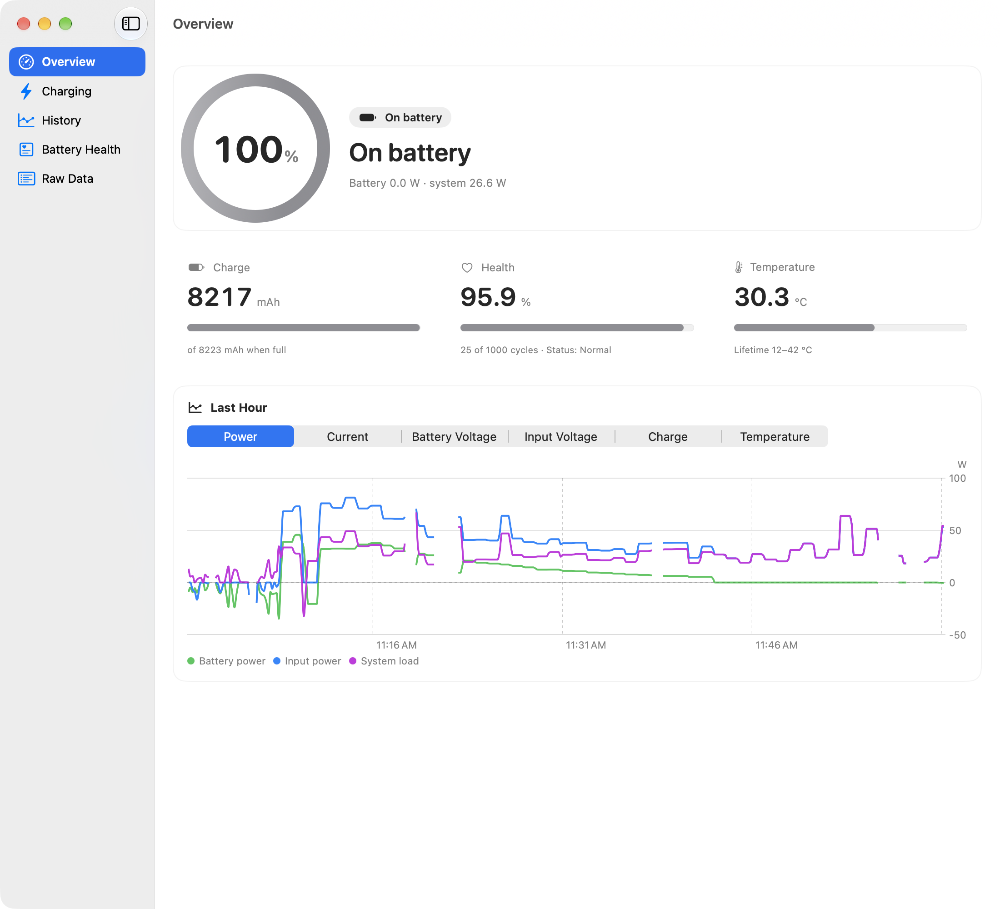
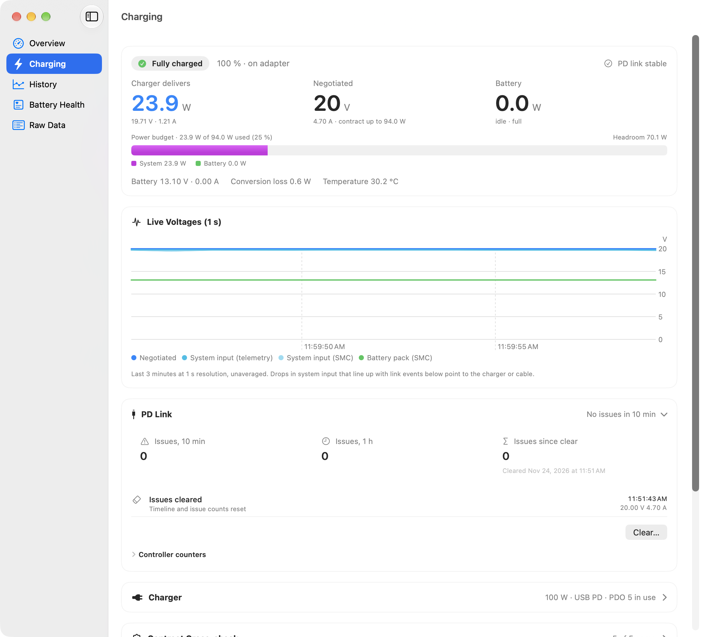
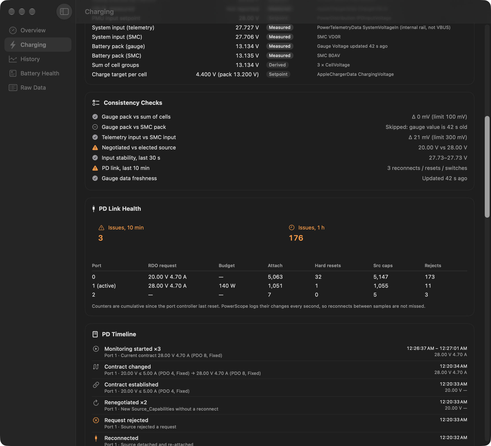
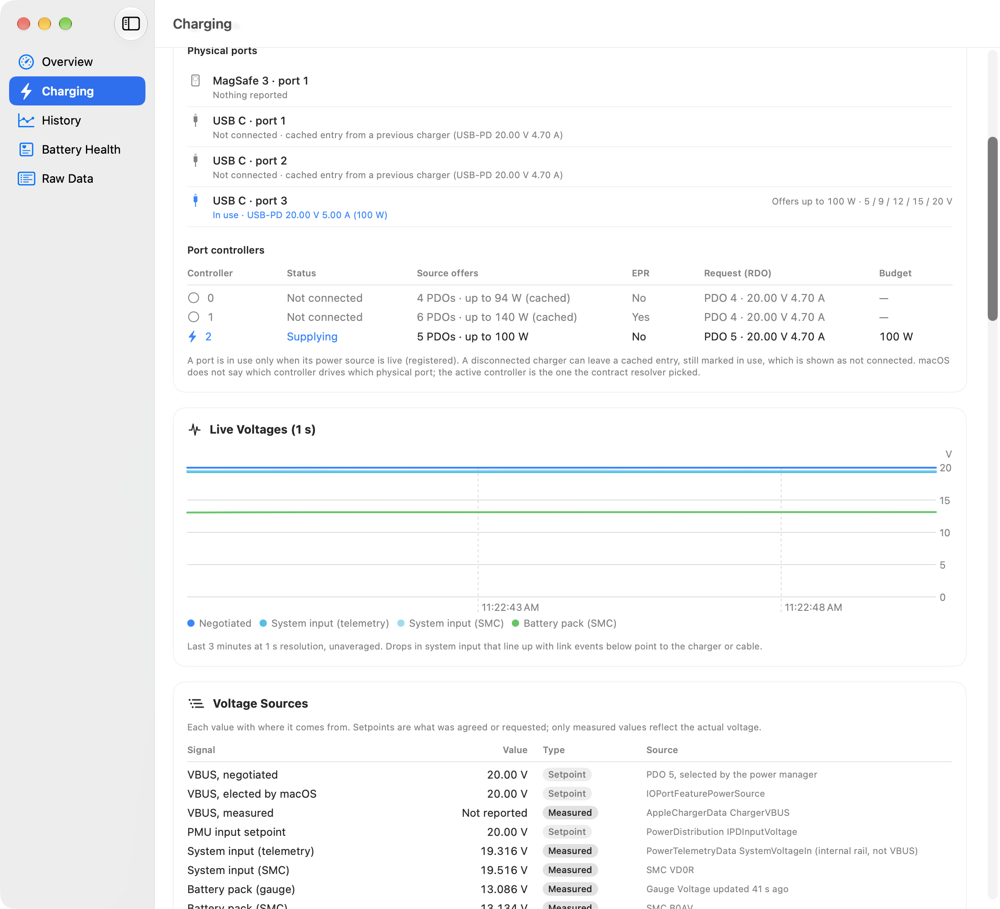
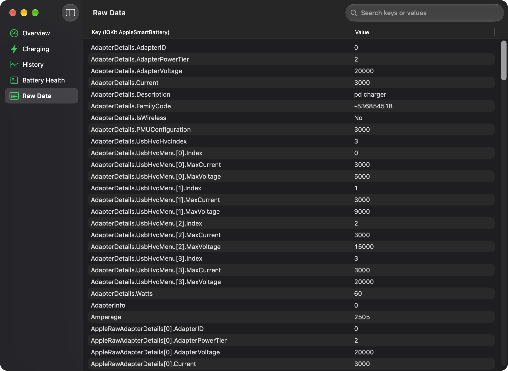
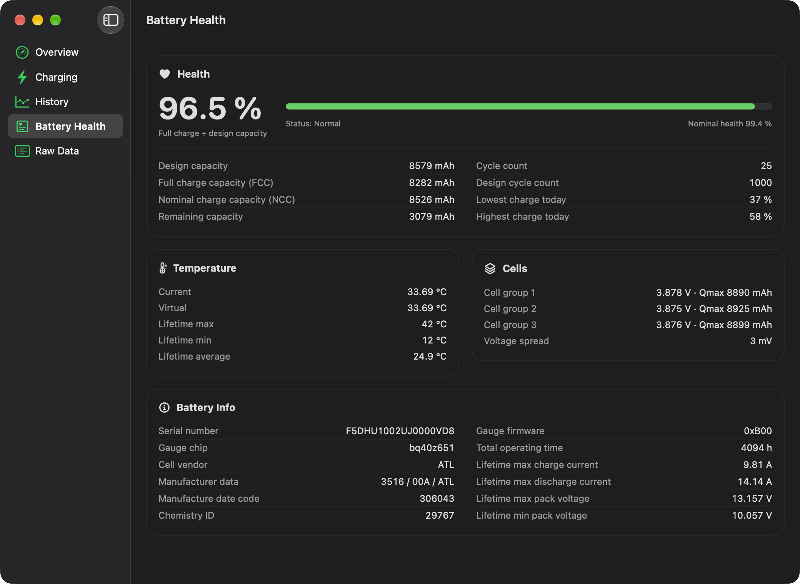
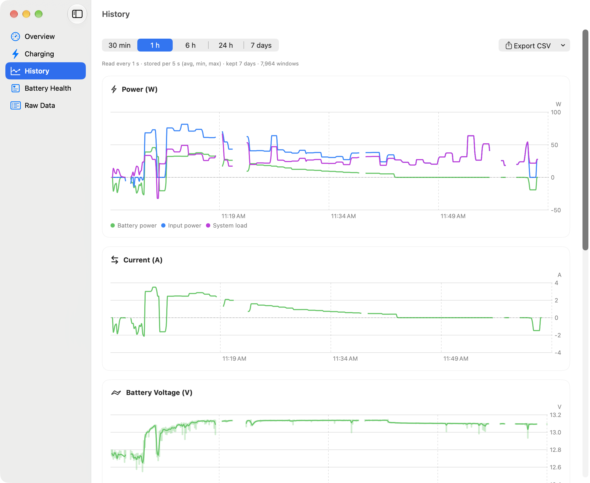
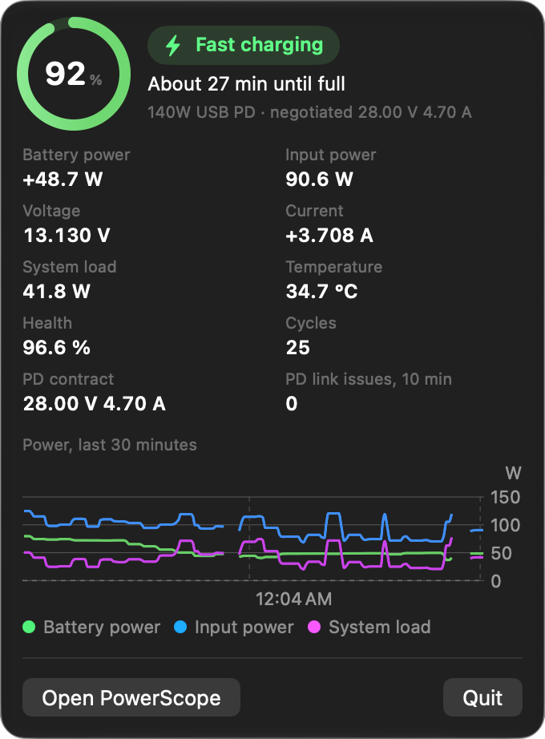
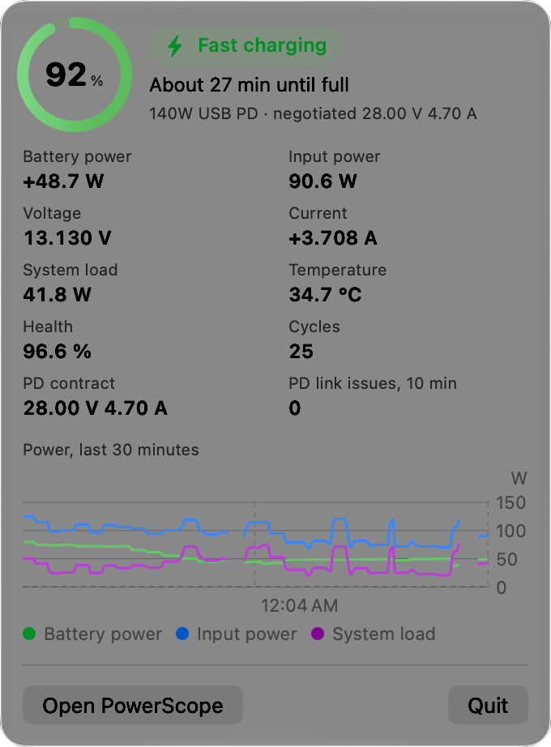
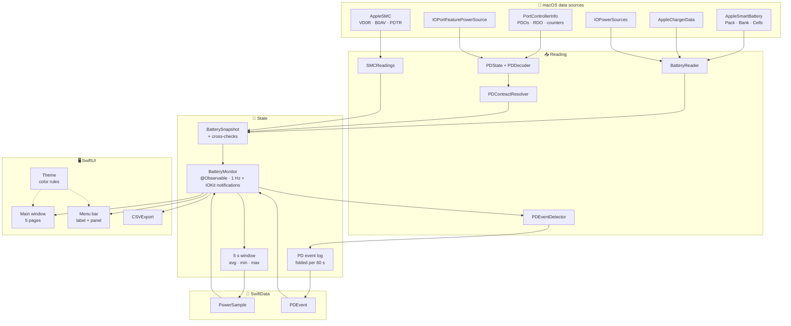

<div align="center">

# ⚡ PowerScope

**A native macOS battery and USB-C Power Delivery monitor that tells you what your charger actually negotiated, and whether the numbers can be trusted.**


[](https://github.com/AndyUneducated/PowerScope/actions/workflows/ci.yml)



</div>

---

## ✨ Features

### 🧭 Overview
- 🔋 **At a glance**: a large charge ring, the state, time to full or time remaining, and a compact power budget bar
- 🗂️ **Three grouped cards** instead of eight tiles: charge (mAh), health (with cycles) and temperature (with its lifetime range); electrical details live on the Charging page

### 🔋 Battery
- 💚 **Health**: full charge ÷ design capacity, plus nominal health and Apple's 80 % service threshold
- 🔁 **Cycles**: cycle count against the rated cycle life
- 🌡️ **Temperature**: current, virtual and lifetime min / max / average
- 🧱 **Cells**: per cell-group voltage and Qmax, with the voltage spread between groups
- 🏷️ **Identity**: serial, gauge chip, cell vendor, manufacture code, chemistry ID, gauge firmware

### 🔌 Charging and USB-C PD
- ⚡ **Now card**: three large readings (what the charger delivers, the negotiated contract, battery power) and a **power budget bar** showing how much of the charger's contract the system and the battery use, and the headroom left; it turns amber when the battery has to help a charger that is not enough
- 🧭 **Ordered by what you check most**: Now, live voltages and PD link come first; charger, cross-check, consistency checks, ports, voltage sources and raw codes are collapsible, show a one-line status when collapsed, and remember whether they are open
- 🤝 **Negotiated contract**: the PDO actually in use (Fixed, PPS, AVS, including EPR 28 V), with voltage, current and power
- 🧮 **Source capabilities**: every PDO the charger offers, decoded per USB PD 3.1, with source flags
- ✅ **Cross-check**: the contract is compared with four other places macOS reports it
- 📡 **Voltage sources**: every voltage labeled as measured, setpoint or derived, with where it comes from
- 🩺 **Consistency checks**: pack vs cells, gauge vs SMC, telemetry vs SMC, input stability, link stability, data freshness
- 🔗 **PD link health**: reconnects, hard resets, renegotiations and rejected requests, logged even between samples. Plugging a charger in or out is not an issue: an isolated re-attach and its handshake fold into one "Charger attached" event, and only repeated re-attaches within 2 minutes count; **Clear** resets the issue counts and timeline (the chip's own totals become a baseline, since they cannot be reset)
- 🔌 **Ports**: every physical USB-C and MagSafe input with the charger actually connected, and every port controller with what its source offers, EPR support, request and power budget; cached entries from a disconnected charger are shown as not connected
- 🚀 **Fast charging**: judged by measured battery power (≥ 30 W), not by the `IsCharging` flag

### 📈 History
- ⏱️ Readings every **1 s**, stored per **5 s window** with average, minimum and maximum
- 🗓️ Kept for **7 days** in SwiftData, together with the PD event log
- 📊 Charts for power, current, battery voltage, input voltage (with the negotiated contract), charge and temperature
- 🕳️ Periods when the app was not running show as gaps, not as straight lines
- 📤 **CSV export** of the full history and the PD event log (File ▸ Export, or the History page)

### 🧭 App
- 🪟 Main window with Overview, Charging, History, Battery Health and Raw Data pages
- 📍 Menu bar item with percentage and live battery power, and a panel with the key numbers
- 💤 Keeps sampling from the menu bar after the window closes, at about 1.8 % of one core

---

## 📸 Screenshots

| Charging: now, live voltages, PD link | Details collapsed with status summaries |
| :---: | :---: |
|  |  |
| **Ports** | **Raw data** |
|  |  |
| **Battery health** | **History** |
|  |  |
| **Menu bar** | **Menu bar, light** |
|  |  |

---

## 🏗️ Architecture



### 🧩 Modules
- 📥 **`BatteryReader`**: copies each IOKit registry entry in one call, so all values come from the same instant
- 🔬 **`PDDecoder`**: pure USB PD 3.1 decoding of PDOs and RDOs (Fixed, Battery, Variable, PPS, EPR AVS, SPR AVS)
- 🧭 **`PDContractResolver`**: decides which contract is in use (see below)
- 🗂️ **`PDState`**: port controllers, physical ports and their sources, the source macOS elected, and the cross-checks
- 🚨 **`PDEventDetector`**: pure detection of PD link events from counter deltas and contract changes, plus the 60 s folding rule
- 📤 **`CSVExport`**: RFC 4180 CSV of history windows and PD events
- 🎛️ **`SMC`**: minimal read-only AppleSMC client (no root needed on Apple Silicon)
- 🫀 **`BatteryMonitor`**: 1 Hz polling plus battery notifications, live 3-minute buffer, 5 s windows, PD event log, retention
- 🎨 **`Theme`**: the single source of every color in the app
- 🖥️ **`Views/`**: pages, charts and the menu bar panel; views stop observing data while their window is hidden

---

## 🎯 How accuracy works

### 🤝 Which PD contract is in use
macOS reports the contract in several places, and none is reliable alone:

| Source | What it gives | Caveat |
| --- | --- | --- |
| 🧭 Power manager (`UsbHvcHvcIndex`) | Which PDO is selected | Reads 255 while the link re-attaches |
| 📟 PMU setpoint (`IPDInputVoltage`) | The input voltage the system is configured for | Falls back to 5 V without a contract |
| 📨 Port controller RDO | The request, including operating current | Lags: kept the old 20 V request for minutes after an EPR 28 V contract started |
| 🗳️ Elected source (`WinningPowerSourceOption`) | macOS's chosen option per port | A disconnected charger's entry stays, unregistered; only registered entries are used |

`PDContractResolver` uses them in this order:
1. 🥇 The power manager's selection, on a port where that PDO agrees with the PMU setpoint
2. 🥈 Otherwise the PDO whose voltage matches the PMU setpoint
3. 🥉 Otherwise the RDO, flagged as unconfirmed

Only controllers with a charger attached (non-zero PD state or source types) are considered: a controller keeps its last charger's PDOs and RDO after it is unplugged, and those cached values must never become the contract. Without external power there is no contract at all.

Then:
- 🔢 PDO positions follow the spec: SPR objects at 1–7, EPR objects from 8
- 🧷 The RDO supplies the operating current only when it names the same PDO; otherwise the PDO limit is shown as `≤`
- 🎚️ PPS / AVS voltages come from a matching RDO or the PMU, never from the PDO maximum

### 📡 Which voltage is real
- 🔵 **Setpoints**: negotiated VBUS, elected VBUS, PMU input setpoint, charge target per cell
- 🟢 **Measured**: system input (telemetry and SMC `VD0R`), battery pack (gauge and SMC `B0AV`)
- 🔋 Battery current and power come from the SMC (`B0AC`, every second); the gauge's `Amperage` can lag by tens of seconds after a plug or unplug, so it is only a fallback, also used when the SMC's direction disagrees with input minus system load
- ⚪ **Derived**: sum of cell groups
- ℹ️ The system input is an internal rail behind the input switches, not VBUS; it reads slightly below the negotiated voltage under load
- ℹ️ This Mac does not report a measured VBUS (`ChargerVBUS` is 0), and the app says so instead of guessing

### 🩺 Consistency checks
- 🔋 Gauge pack vs sum of cells: within 30 mV + 35 mΩ × |I|
- 🔄 Gauge pack vs SMC pack: only when the gauge value is under 2 s old
- 🔌 Telemetry input vs SMC input: only while the input is steady
- 🤝 Negotiated vs elected source
- 📉 Input stability over the last 30 s
- 🔗 PD link stability over the last 10 minutes
- ⏳ Gauge data freshness

---

## 🎨 Colors

One rule, defined in `Theme.swift`: **a color says where energy flows and whether anything needs attention.**

| Color | Meaning | Examples |
| --- | --- | --- |
| 🟢 Green | Energy flowing into the battery, brighter when faster | Fast ≥ 30 W, charging, trickle < 10 W |
| ⚪ Neutral | Normal and calm | Plugged in and paused, full (green check), on battery above 20 % |
| 🟠 Amber | Needs attention | Battery assisting a weak adapter, ≤ 20 % on battery, PD link problems |
| 🔴 Red | Act now | ≤ 10 % on battery, critical level |

- 📊 **Chart series** are colored by source everywhere: 🔵 supply side, 🟢 battery, 🟣 system load, ⚪ temperature
- 🧮 **Metric tiles** stay neutral and only turn amber or red when a value is off (temperature ≥ 40 / 45 °C, health < 80 %, cycles past design)
- 🎛️ The app follows the system accent color

---

## ⚙️ Performance
- 📥 One full read costs under 1 ms; reading only selected keys would save about 0.07 ms and lose the single-instant snapshot
- 💤 SwiftUI keeps closed windows and the menu bar panel alive, so views stop observing data while hidden
- 🗃️ The Raw Data list is built only while that page is open
- 📏 Measured on the Release build: **~1.8 %** of one core in the background, **~2.8 %** with the main window open

---

## 🧪 Tests
68 Swift Testing tests in `PowerScopeTests/`, run on every push by [GitHub Actions](https://github.com/AndyUneducated/PowerScope/actions/workflows/ci.yml). They replay PD data captured from a real Mac with Apple's 140 W adapter over three cables:
- 🔬 **Decoding**: 60 W, 94 W and 140 W PDOs, EPR AVS, PPS, source flags, EPR positions, RDOs
- 🧭 **Contract resolution**: stale RDO, RDO catching up, 5 V fallback, stale power budget, PMU vs selection, AVS, PPS, RDO-only
- 🚨 **Event detection**: counter deltas, counter resets, new ports, contract transitions, current appearing, the 60 s fold window
- ✅ **Cross-checks** for the EPR case
- 💾 **Storage**: a first-release store opening with the current models (migration), and sample round trips
- 📤 **CSV**: escaping, column values, empty unknowns, event ordering and quoting
- 🧹 **Clearing issues**: counts since the clear, no baseline, controller resets after a clear
- 🔋 **Battery current source**: SMC over a stale gauge, gauge fallback, energy-balance guard
- 🔌 **Plug-in vs flaky link**: the real 100 W plug-in folds into one non-issue event, the failing cable's repeated re-attaches all count, unplugging is not an issue
- 🎨 **Color rules**: charging speed, battery thresholds, battery assisting, reading levels
- 🔌 **Ports and stale data**: only live (registered) sources count as in use; controllers without an attached charger are never used for the contract, and there is no contract on battery
- 📊 History downsampling, formatting and registry parsing

```bash
xcodebuild test -project PowerScope.xcodeproj -scheme PowerScope -destination 'platform=macOS'
```

---

## 📦 Install
- ⬇️ Download the latest `PowerScope-vX.Y.Z.zip` from [Releases](https://github.com/AndyUneducated/PowerScope/releases) and unzip it
- 📂 Move `PowerScope.app` to `/Applications`
- 🔓 The app is signed ad hoc, so clear the download quarantine once:
  ```bash
  xattr -dr com.apple.quarantine /Applications/PowerScope.app
  ```
- 🍏 Requires macOS 15 or later on Apple Silicon

## 🛠️ Build from source

```bash
xcodebuild -project PowerScope.xcodeproj -scheme PowerScope -configuration Release -derivedDataPath build/DerivedData build
ditto build/DerivedData/Build/Products/Release/PowerScope.app /Applications/PowerScope.app
open /Applications/PowerScope.app
```

- 🔏 Signed ad hoc ("Sign to Run Locally"); App Sandbox is off because the app reads the IOKit registry and the SMC directly
- 🧭 `open PowerScope.app --args -page charging` opens a given page (`overview`, `charging`, `history`, `battery`, `raw`)

## 🚀 Releasing
- 🏷️ Versions follow [Semantic Versioning](https://semver.org); the current version is **1.2.0**
- 📝 Bump `MARKETING_VERSION` in the project and add notes in `docs/releases/vX.Y.Z.md`
- 🔖 Push a tag `vX.Y.Z`: the [Release workflow](.github/workflows/release.yml) checks the tag matches the app version, runs the tests, builds the app and publishes `PowerScope-vX.Y.Z.zip` with its SHA-256

---

## 📁 Project structure

```
PowerScope/
├── PowerScopeApp.swift          App, window and menu bar scenes
├── BatteryMonitor.swift         Polling, live buffer, 5 s windows, PD events, persistence
├── BatteryReader.swift          IOKit and IOPowerSources reading
├── BatterySnapshot.swift        One reading and its derived values
├── PowerSample.swift            SwiftData models (PowerSample, PDEvent)
├── Theme.swift                  Color rules
├── Format.swift                 Number and time formatting
├── Export/CSVExport.swift       CSV export
├── PowerDelivery/
│   ├── PDDecoder.swift          USB PD 3.1 PDO / RDO decoding
│   ├── PDContractResolver.swift Which contract is in use
│   ├── PDEventDetector.swift    PD link events from counter deltas
│   ├── PDState.swift            Port controllers, elected source, cross-checks
│   └── SMC.swift                Read-only AppleSMC client
└── Views/                       Pages (ChargingViews for the Charging page), charts, menu bar panel, components
PowerScopeTests/                 Swift Testing suites
docs/releases/                   Release notes, one file per version
docs/screenshots/                Screenshots used in this README
.github/workflows/               Tests on every push, releases on tags
```

---

## ⚠️ Limitations
- 🔌 The registry does not say whether the source is on USB-C or MagSafe 3, so the type reads "USB PD"
- 📏 Without a measured VBUS, the true adapter output voltage needs an external USB-C meter to verify
- 🍎 Relies on undocumented IOKit keys and SMC keys that Apple may change between macOS releases
